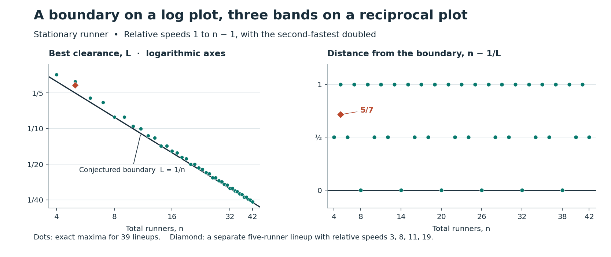

# How close do doubled-speed lineups come to the Lonely Runner boundary?

Count the stationary runner in the total, $n$. For this runner, let $L$ be the maximum over time of the distance to its nearest opponent on the unit circle. The Lonely Runner Conjecture predicts $L\ge 1/n$. On logarithmic axes the boundary is the straight line $\log L=-\log n$. The quantity $B=n-1/L$ expands the region near that line. Zero means the runner just attains the target, and a negative value would contradict the conjecture.



Start with relative speeds $1,\dots,n-1$ and double the second-fastest, replacing $n-2$ by $2(n-2)$. The following values were checked exactly for **each** $4\le n\le42$, one lineup and one reference per runner count.

| Total runners in the check | Best clearance $L$ | $B=n-1/L$ |
| --- | --- | --- |
| $8,14,20,26,32,38$ | $1/n$ | $0$ |
| All other even counts | $2/(2n-1)$ | $1/2$ |
| All odd counts | $1/(n-1)$ | $1$ |

Goddyn and Wong already characterize when a single accelerated speed gives a tight example. This computation records the actual clearance, including the two positive bands, over the displayed range. For a different family, the Fan–Sun example with relative speeds $3,8,11,19$ gives $L=7/30$ and hence $B=5/7$. This comparison rules out the three-band description for arbitrary lineups.

Sources: [Goddyn and Wong, *Tight instances of the lonely runner*](https://www.sfu.ca/~goddyn/Papers/063tight_lonely_runner.pdf) and [Fan and Sun, *Amending the Lonely Runner Spectrum Conjecture*](https://doi.org/10.37236/13840).

## Reproduce the finite check

Run the following Python code from the repository root. The checker intersects closed rational intervals over a full period. A nonempty set of isolated times at the proposed clearance proves attainment. By continuity, any strictly higher clearance would leave a whole interval feasible at the proposed value.

```python
from fractions import Fraction
from lonely_runner.checker import feasible_intervals

def check_maximum(speeds, clearance):
    intervals = feasible_intervals(speeds, clearance)
    assert intervals and all(left == right for left, right in intervals)

for n in range(4, 43):
    speeds = (set(range(1, n)) - {n - 2}) | {2 * (n - 2)}
    if n % 2:
        clearance = Fraction(1, n - 1)
    elif n % 6 == 2:
        clearance = Fraction(1, n)
    else:
        clearance = Fraction(2, 2 * n - 1)
    check_maximum(speeds, clearance)
check_maximum([3, 8, 11, 19], Fraction(7, 30))
```

[Two replacements and the growth of their speeds](../two-replacements/README.md). A candidate polynomial bound for every runner count from five onward, all-speed checks at five counts, and all sixteen physical roles in the two-replacement family at 16.
